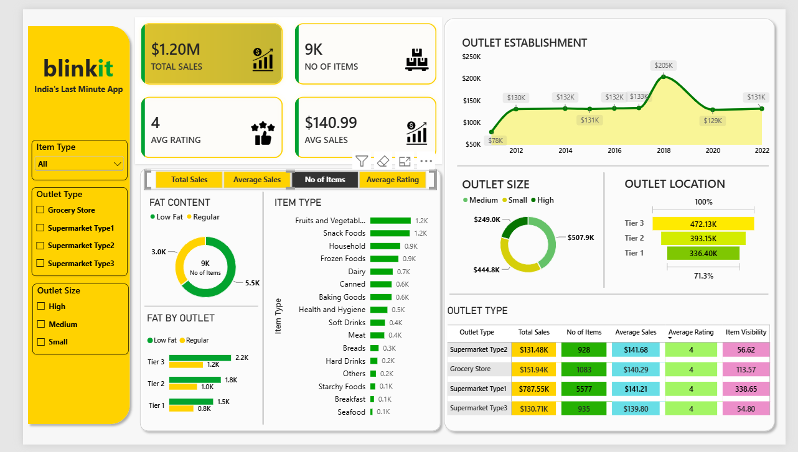

# Blinkit Grocery Sales Analysis | SQL & Power BI

## Project Overview

This project analyzes Blinkit grocery sales data using **SQL and Microsoft Power BI** to understand sales performance, product category trends, outlet characteristics, and key business metrics.

The objective is to transform raw sales data into meaningful insights through data cleaning, SQL analysis, KPI calculations, and an interactive Power BI dashboard.

## Dashboard Preview

## Objectives

- Analyze overall sales performance and key KPIs.
- Compare sales across different product categories.
- Analyze Low Fat and Regular product sales.
- Evaluate outlet performance by size, location and type.
- Identify high-performing product categories and outlet segments.
- Build an interactive dashboard for business decision-making.

## Tools & Technologies

- **SQL** – Data analysis, data cleaning, aggregations, grouping, pivoting, and window functions.
- **Microsoft Power BI** – Dashboard development and data visualization.
- **Microsoft Excel** – Data inspection and preparation.
- **CSV & JSON** – Data formats.

## Dataset Description

The dataset contains grocery item and outlet-level information.

| Column | Description |
|---|---|
| Item Fat Content | Fat category of the product |
| Item Identifier | Product identifier |
| Item Type | Product category |
| Outlet Establishment Year | Outlet establishment year |
| Outlet Identifier | Unique outlet identifier |
| Outlet Location Type | Tier classification |
| Outlet Size | Outlet size |
| Outlet Type | Outlet business type |
| Item Visibility | Product visibility metric |
| Item Weight | Product weight |
| Total Sales | Sales value |
| Rating | Item/outlet rating field |

## SQL Analysis

The project uses SQL to perform:

- Data exploration and inspection
- Data cleaning and standardization
- KPI calculations using `SUM`, `AVG`, and `COUNT`
- Sales analysis by product category
- Sales analysis by fat content
- Sales comparison by outlet location
- Outlet size analysis
- Outlet establishment year analysis
- `GROUP BY` and `ORDER BY`
- `CASE` statements
- `PIVOT` analysis
- Window functions

## Key Performance Indicators (KPIs)

- Total Sales
- Number of Items / Records
- Average Sales
- Average Rating

## Dashboard Features

- KPI cards for important metrics
- Sales by Fat Content
- Sales by Item Type
- Sales by Outlet Establishment Year
- Outlet Size analysis
- Outlet Location analysis
- Outlet Type performance
- Interactive slicers for filtering and exploration

## Key Insights

- Fruits & Vegetables and Snack Foods are among the leading sales categories.
- Medium-sized outlets contribute a significant share of total sales.
- Supermarket Type1 represents a major contributor to overall sales.
- Outlet performance varies across location tiers and outlet types.
- Product category and outlet characteristics can help guide sales and merchandising decisions.

## Business Recommendations

- Focus on top-performing product categories to improve merchandising decisions.
- Evaluate sales performance across different outlet types and locations.
- Review the performance of medium-sized outlets to identify opportunities.
- Use category-level insights to support product assortment and promotional planning.
- Leverage dashboard filters to explore performance across different outlet characteristics.

## Project Files

- `Dashboard/` – Power BI dashboard file
- `SQL/` – SQL queries used for analysis
- `Dataset/` – Cleaned dataset
- `Screenshots/` – Dashboard images
- `Report/` – Detailed project report

## Conclusion

This project demonstrates the use of SQL for data analysis and Microsoft Power BI for interactive reporting. It highlights how sales data can be transformed into business insights to support data-driven decisions related to product categories and outlet performance.

---

**Tools:** SQL | Power BI | Excel | Data Analysis | Data Visualization
